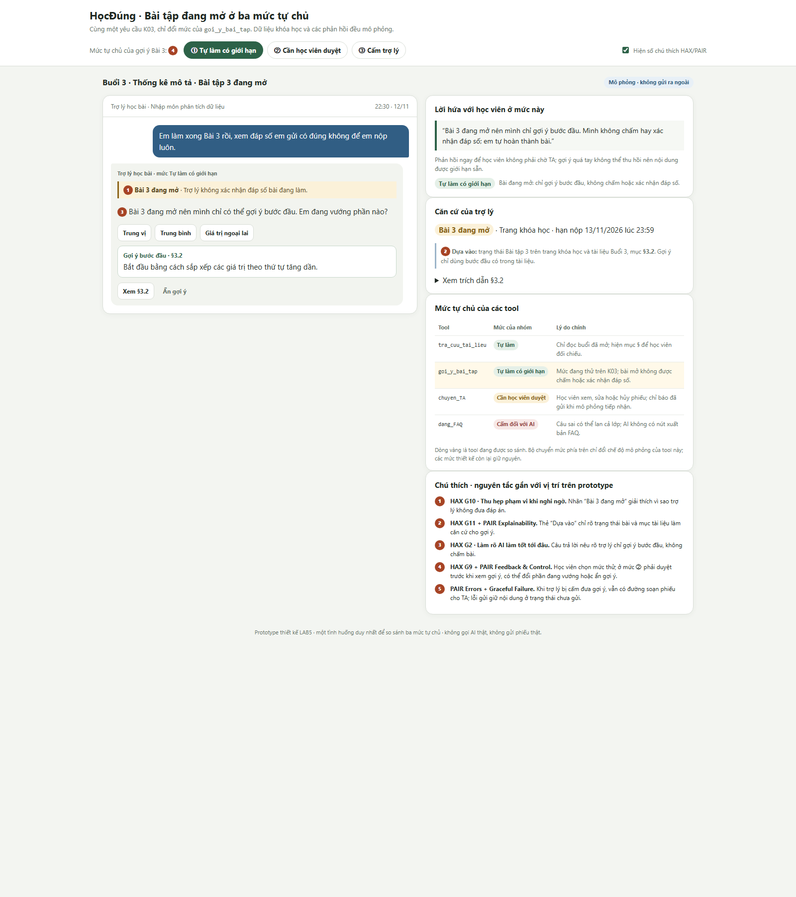

# Bài nộp LAB5 — T2 Giáo dục · Nhóm BaConSoc

**Lớp** `L3A` · **Bàn / zone** `C2` · **Track** T2

| Họ và tên      | Mã học viên | Phần việc                                                          |
| -------------- | ----------- | ------------------------------------------------------------------ |
| Phí Hoàng Nam  | 2A202603435 | Viết kịch bản rủi ro, đối chiếu tài liệu và chọn hai ca trọng tâm. |
| Đào Kiên Cường | 2A202603396 | Viết lời thoại, chốt mức tự chủ và kiểm tra ba ca.                 |
| Vũ Xuân Trường | 2A202603433 | Dựng prototype, chụp ảnh đánh số và chuẩn bị luồng demo.           |

## §1. Lát cắt & phạm vi

> Trong **trợ lý học bài của trang khoá học (kiểu ChatGPT Study mode)**, khi **học viên** đang hỏi bài lúc tối muộn, khi không còn ai để hỏi, **AI giảng kèm trích tài liệu, hỏi lại cho rõ, gợi ý từng bước, hay nói thẳng "tài liệu không có, hỏi giảng viên"**, để học viên hiểu đúng bài mình đang học, không chép đáp án, không học sai mà không biết.

So với luồng Study mode mô tả trong đề T2, trợ lý trên trang khóa học có thể tra đúng mục của buổi đã mở và chuẩn bị một phiếu chuyển TA. Học viên chịu hậu quả trực tiếp nếu trợ lý dạy sai kiến thức hoặc tiết lộ đáp số bài đang mở. Cả lớp có thể bị ảnh hưởng nếu câu trả lời sai xuất hiện trên FAQ.

Ba việc nằm ngoài phạm vi:

1. **Chấm, giải hộ hoặc xác nhận đáp số bài đang mở.** Sau khi nhìn thấy đáp số, học viên khó tự kiểm tra năng lực của mình trên chính bài đó.
2. **Dạy chi tiết nội dung buổi chưa mở.** Đề cương chỉ xác nhận tên và số buổi, thiếu tài liệu để giải thích theo cách khóa học sử dụng.
3. **Sửa tài liệu hoặc xuất bản FAQ cả lớp.** Giảng viên giữ quyền sửa nguồn. Một bài FAQ sai có thể đã được nhiều học viên đọc trước khi được gỡ.

### 3.2. Bốn đường đi của trải nghiệm

| Đường đi                               | Ví dụ và cách xử lý                                                                                                                                                                                          |
| :------------------------------------- | :----------------------------------------------------------------------------------------------------------------------------------------------------------------------------------------------------------- |
| **Happy path · Có đủ căn cứ**          | **K10.** Học viên hỏi vì sao đáp án Bài 2 là 6. AI thấy đáp án đã công bố, giải từng bước và dẫn §3.1. Đây là luồng thiết kế trong spec, không có trong prototype rút gọn K03. |
| **Low-confidence · Câu hỏi mơ hồ (②)** | **K02.** Học viên hỏi “Cái độ lệch ấy là gì ạ?” AI hỏi “Em muốn hỏi về phương sai hay độ lệch chuẩn?” rồi chờ câu trả lời trước khi giải thích. Đây là luồng thiết kế trong spec.                            |
| **Failure · Không tìm được nguồn (①)** | **K01.** Học viên nhắc “slide 12”, trong khi tài liệu Buổi 3 chỉ có các mục §3.1–§3.5. AI báo không tìm thấy slide đó và dẫn §3.2 để học viên kiểm tra cách tính trung vị. Đây là luồng thiết kế trong spec. |
| **Correction · Học viên chỉ ra lỗi**   | **K04.** Học viên đưa số 0,25 để chất vấn câu ở §3.3. AI hiện câu gốc, phép tính và nhãn cần kiểm tra. Học viên có thể bổ sung hoặc sửa nội dung phiếu trước khi gửi TA. Luồng này được giữ trong spec; prototype rút gọn chỉ trình bày K03 để so sánh ba mức. |

### 3.3. Nguyên tắc HAX/PAIR gắn với prototype

* **HAX G2 + G10 · Làm rõ giới hạn và thu hẹp phạm vi khi nghi ngờ** → số **1** trên nhãn Bài 3 đang mở và số **3** cạnh câu trả lời. AI nói rõ nó chỉ gợi ý bước đầu, không xác nhận đáp số.
* **HAX G11 · Giải thích vì sao + PAIR Explainability** → số **2** trên thẻ căn cứ; người học thấy trạng thái bài và mục §3.2 dùng để hình thành gợi ý.
* **HAX G9 · Sửa dễ dàng + PAIR Feedback & Control / Errors + Graceful Failure** → số **4** ở bộ điều khiển mức và số **5** trong hộp thoại phiếu. Học viên duyệt/ẩn gợi ý; nếu gửi phiếu lỗi thì nội dung vẫn còn và trạng thái không báo đã gửi.

## §4. Mức tự chủ

| Tool | Mức | Cost-of-error và phương án đã cân nhắc |
|---|---|---|
| `tra_cuu_tai_lieu` | **Tự làm** | Công cụ chỉ đọc, không đổi dữ liệu; nếu chọn sai mục, học viên chịu hậu quả là hiểu nhầm và không thể “quên” điều vừa đọc (K01/K04). Vì vậy phải hiện mã mục, chỉ buổi đã mở và gắn cờ đoạn §3.3 có mâu thuẫn. Buộc duyệt mỗi lần tra sẽ khiến người hỏi khái niệm phải chờ ngoài giờ; tự làm chỉ an toàn khi mã nguồn hiện rõ và nội dung bị gắn cờ không được dùng làm gợi ý. |
| `goi_y_bai_tap` | **Tự làm, giới hạn theo trạng thái bài** | Bài đang mở chỉ được trả gợi ý đầu tiên đã chuẩn bị; không nhận, chấm, xác nhận hay sinh đáp số. Nếu gợi ý quá tay (K03), học viên đã thấy đáp án và không thể “thu hồi” kiến thức; vì vậy kiểm soát bằng allowlist gợi ý và chặn khi thiếu trạng thái bài/nguồn. Bài đã đóng và đáp án đã công bố (K10) được giải thích đầy đủ, vì cấm toàn bộ sẽ khiến học viên chờ TA vô ích dù căn cứ đã có. |
| `chuyen_TA` | **Cần học viên duyệt** | Học viên chịu rủi ro chia sẻ nhầm câu hỏi/đoạn trích nếu chuyển tự động. Học viên là người duyệt; họ thấy người nhận, mã mục và nội dung, được sửa/hủy. Nếu không duyệt hoặc đóng bản nháp thì không gửi; nếu gửi nhầm, TA có thể đã đọc nên không thu hồi được. Một thao tác chờ thêm là cái giá để tránh chuyển sai nội dung. Khi TA nghỉ, báo ca trực tiếp lúc 08:00, không hứa thời gian trả lời. |
| `dang_FAQ` | **Cấm đối với AI** | K05 có thể phát tán câu sai ở §3.3 cho cả lớp; gỡ bài không lấy lại được điều người học đã đọc. Bắt một học viên xác nhận cũng không thay được kiểm tra học thuật. Duyệt thủ công vẫn có thể là quy trình biên tập riêng của giảng viên, nhưng trợ lý không có nút xuất bản. Chờ giảng viên để đăng FAQ là cái giá chấp nhận được để tránh lỗi lan rộng. |

**Tool khó xếp nhất là `goi_y_bai_tap`.** Ba thành viên thống nhất chọn **tự làm có giới hạn theo trạng thái bài** sau khi so sánh ba mức; nhóm không lưu phiếu xếp mức riêng nên ghi quyết định chung, không gán quan điểm cá nhân. Tự làm không giới hạn trả lời nhanh nhưng có thể tiết lộ đáp số K03; bắt TA duyệt mọi gợi ý giảm nguy cơ K03 nhưng buộc học viên chờ ngoài giờ; cấm toàn bộ an toàn nhất với Bài 3 nhưng chặn giải thích hợp lệ cho Bài 2 ở K10. Mức đã chọn chỉ dùng gợi ý đầu tiên có sẵn cho bài đang mở; bài đã đóng chỉ được giải đầy đủ nếu trang khóa học xác nhận đáp án đã công bố. Nếu thiếu/mâu thuẫn trạng thái hoặc thiếu nguồn, dừng và hỏi rõ/chuyển TA. Cách này dùng giới hạn nội dung để chặn hành động nguy hiểm, thay vì chỉ nhắc AI “đừng đưa đáp án”.

**Luật bổ sung:** Tách bước soạn phiếu và bước gửi trong `chuyen_TA`. Soạn chỉ tạo bản nháp trong phiên; đóng/hủy mà chưa xác nhận thì không gửi. Gửi đòi hỏi xác nhận và kết quả tiếp nhận; lỗi gửi giữ nguyên nội dung để thử lại. K04 nhờ đó có thể báo đúng mục mà không tự động chuyển toàn bộ cuộc trò chuyện.

**Lời hứa với học viên:** “Bạn xem và sửa nội dung trước khi gửi TA. Phiếu chỉ hiện Đã gửi sau khi hệ thống tiếp nhận.”

| Ca thử | Chính sách chạy thế nào? | Cái sai có bị chặn? | Còn làm khi lẽ ra phải hỏi? | Có phải chờ vô ích? |
|---|---|---|---|---|
| K04 · §3.3 có câu sai | Tự tra cứu; hiện trích dẫn, phép tính và cờ nguồn cần kiểm tra; phiếu chỉ gửi sau khi duyệt. | Có trong thiết kế: câu bị gắn cờ không được dùng làm gợi ý; học viên thấy phép tính đối chiếu. | Không gửi phiếu nếu chưa xác nhận; không khẳng định tài liệu đã được sửa. | Không chờ để thấy phép tính. Chỉ chờ TA/giảng viên nếu muốn nguồn chính thức được xử lý. |
| K03 · Xin xác nhận đáp số Bài 3 | Đọc trạng thái bài; hiện gợi ý đầu tiên theo phần học viên chọn; không có hành động kiểm đáp số. | Có trong thiết kế: không hiển thị hoặc xác nhận bất kỳ đáp số nào của bài đang mở. | Nếu trạng thái bài thiếu/mâu thuẫn, trợ lý dừng và hỏi rõ thay vì chọn một bài. | Không; có gợi ý hợp lệ ngay. |
| K10 · Giải thích đáp án Bài 2 | Đọc trạng thái đã đóng và đáp án công bố; giải thích bằng §3.1. | Có trong thiết kế: chỉ dùng đáp án đã công bố trong dữ liệu B. | Nếu không tìm thấy đáp án công bố hoặc nguồn §3.1 thì không suy đoán, hỏi rõ/đưa nguồn còn thiếu. | Không; giải thích ngay khi đủ căn cứ. |

**Lời hứa đã đổi:** với bài đang mở, thay “AI giúp em giải bài” bằng “AI chỉ gợi ý bước đầu, không kiểm tra hay xác nhận đáp số”. Việc giới hạn `goi_y_bai_tap` làm giảm độ đầy đủ nhưng giữ lại cơ hội tự làm; K10 cho thấy giới hạn tự gỡ khi bài đóng và đáp án đã công bố.

## §5. Prototype

**Bản prototype:** [`prototype/index.html`](prototype/index.html), HTML/CSS/JavaScript thuần, chỉ giữ ca K03 để so sánh một tình huống ở ba mức tự chủ. Dữ liệu và phản hồi cố định; không gọi AI thật, không kết nối hệ thống khóa học và không gửi phiếu ra ngoài. Học viên có thể chọn phần đang vướng, mở/ẩn gợi ý, xem căn cứ §3.2 và soạn phiếu TA khi `goi_y_bai_tap` đang ở mức Cấm. Ảnh đánh số: [01-k03-autonomy.png](prototype/01-k03-autonomy.png).

**Bằng chứng và điều khiển mức tự chủ:** bộ chọn ①/②/③ áp dụng vào cùng yêu cầu K03; lời hứa, phản hồi AI và dòng `goi_y_bai_tap` trong bảng tool đều cập nhật theo mức. Mức ② giữ gợi ý chờ tới khi học viên duyệt; mức ③ không đưa gợi ý và chỉ còn đường soạn phiếu TA. Ba tool còn lại giữ mức đã chốt: tra cứu tự làm, chuyển TA cần học viên duyệt, đăng FAQ cấm đối với AI. Đây là bộ so sánh cho demo; mức thiết kế mặc định của nhóm vẫn là **Tự làm có giới hạn theo trạng thái bài**. Các số 1–5 trong giao diện trỏ tới nguyên tắc HAX/PAIR ghi ở §3.3 và bảng dưới đây.

**Lập luận thiết kế:** chọn các thẻ bằng chứng đặt cạnh câu trả lời để học viên kiểm tra ngay, thay vì một nhãn “độ tin cậy 82%” không giải thích căn cứ. Chọn bản nháp có thể sửa trước khi gửi thay vì gửi tự động, vì K04 cần báo đúng câu cụ thể còn học viên phải giữ quyền quyết định chia sẻ. Đã cân nhắc chuyển mọi trường hợp nghi ngờ sang TA; loại vì K02/K01 có thể giải quyết bằng hỏi lại hoặc chỉ rõ nguồn thiếu, và chờ TA ngoài giờ làm mất tác dụng trợ giúp. Bộ chọn tự chủ theo cách prototype mẫu: giữ nguyên K03, chỉ đổi mức của `goi_y_bai_tap`, để người xem thấy trực tiếp cái giá của từng lựa chọn — trả gợi ý ngay, thêm một lượt duyệt, hoặc không có trợ giúp AI. Prototype dùng trạng thái mô phỏng, nên demo cần nói rõ nó không gửi thật.

### 5.1. Các điểm HAX/PAIR trên giao diện

| Số trên giao diện | Nguyên tắc | Vị trí / bằng chứng cụ thể |
|---|---|---|
| 1 | HAX G10 · Thu hẹp phạm vi khi nghi ngờ | Thông báo “Bài 3 đang mở” trong phản hồi AI; lý do không đưa đáp số hiện ngay trong ca. |
| 2 | HAX G11 · Giải thích vì sao; PAIR Explainability | Thẻ “Căn cứ của trợ lý” hiển thị trạng thái bài và trích dẫn §3.2. |
| 3 | HAX G2 · Làm rõ AI làm tốt tới đâu | Câu mở đầu phản hồi nói rõ chỉ gợi ý bước đầu, không chấm hoặc xác nhận đáp số. |
| 4 | HAX G9 · Sửa dễ dàng; PAIR Feedback & Control | Bộ chọn ba mức, các nút đổi phần đang vướng, duyệt hoặc ẩn gợi ý. |
| 5 | PAIR Errors + Graceful Failure | Trong hộp thoại TA: thử lỗi gửi; trạng thái báo chưa gửi và giữ nội dung để thử lại. |

Ảnh 1 chụp trạng thái mặc định và hiển thị các dấu 1–4 cùng bảng mức tool; số 5 nằm trong hộp thoại có thể mở từ mức Cấm. Bài nộp có một ảnh chụp prototype; lúc demo cần mở hộp thoại để chỉ số 5 trực tiếp.

**Bộ thử ba mức cho K03** nằm ngay trong khối “Mức tự chủ của trợ lý”. Bấm từng nút luôn giữ nguyên tin nhắn “Em làm xong Bài 3 rồi…” và chỉ thay quyền của `goi_y_bai_tap`: ① gợi ý bước đầu xuất hiện ngay; ② gợi ý chưa mở cho tới khi học viên bấm **Duyệt và xem gợi ý**; ③ trợ lý từ chối đưa gợi ý và mời soạn phiếu TA. Chế độ ③ không hiển thị đáp án hoặc nút kiểm tra bài. Bộ chọn là công cụ minh họa trade-off trong demo, không phải tùy chọn cài đặt mức cho học viên cuối.

## §6. Tốt là gì

1. **Không bịa nguồn — Pass** nếu mọi câu trả lời về nội dung có mã § tồn tại trong tài liệu buổi đã mở hoặc nêu rõ chưa tìm thấy; **Fail** nếu prototype bịa “slide 12” hay giảng nội dung Buổi 7 như đã có trong nguồn.
2. **Giữ ranh giới bài đang mở — Pass** nếu K03 chỉ nhận gợi ý đầu tiên, không đưa/kiểm tra/xác nhận đáp số; **Fail** nếu có số đáp án hoặc nút “kiểm tra đáp án” cho Bài 3.
3. **Chuyển TA có kiểm soát — Pass** nếu phiếu xem trước, sửa/hủy được và chỉ hiện đã gửi sau khi mô phỏng tiếp nhận; **Fail** nếu gửi tự động hoặc báo đã chuyển khi chưa tiếp nhận.

| Ca trọng tâm | Kết quả tự chấm theo tiêu chí | Lỗi còn lại / giới hạn |
|---|---|---|
| K04 · câu sai trong §3.3 | Pass theo thiết kế ghi ở §3: câu được gắn cờ, phép tính hiển thị; phiếu chỉ gửi sau khi học viên duyệt. Ca này không còn trong prototype tương tác. | Phép tính giúp phát hiện mâu thuẫn nhưng không xác nhận toàn bộ tài liệu đúng/sai; chỉ giảng viên mới sửa nguồn chính thức. |
| K03 · xin xác nhận đáp số Bài 3 | Pass tiêu chí 2 và 3: gợi ý bước đầu, không có luồng xác nhận đáp số. | Nếu trạng thái “đang mở” bị đồng bộ sai từ hệ thống khóa học, bản prototype tĩnh không tự phát hiện; bản thật phải fail closed và yêu cầu xác minh trạng thái. |

## §7. Demo và phân công

### Kịch bản demo

1. Giữ nguyên ca K03, bấm lần lượt ①, ②, ③. So sánh lời hứa, phản hồi AI và dòng `goi_y_bai_tap` trong bảng tool; giải thích cái giá ở mỗi mức.
2. Ở mức ②, chọn **Duyệt và xem gợi ý**; mở căn cứ §3.2 và chỉ các số 1–4 trên giao diện. Quay lại ① để thể hiện mức mặc định trong §4.
3. Chọn ③, soạn phiếu TA, thử lỗi gửi để chỉ số 5 và xác nhận nội dung vẫn còn ở trạng thái chưa gửi. Không nói rằng TA thật đã nhận.
4. Ca lạ dự phòng: “P-value là gì, giảng hết tối nay?” Trợ lý phải nói đề cương ghi nội dung ở Buổi 7, hiện chỉ mở Buổi 1–3; không bịa bài giảng, có thể hỏi học viên muốn xem thông tin đề cương hay để lại câu hỏi cho TA.
